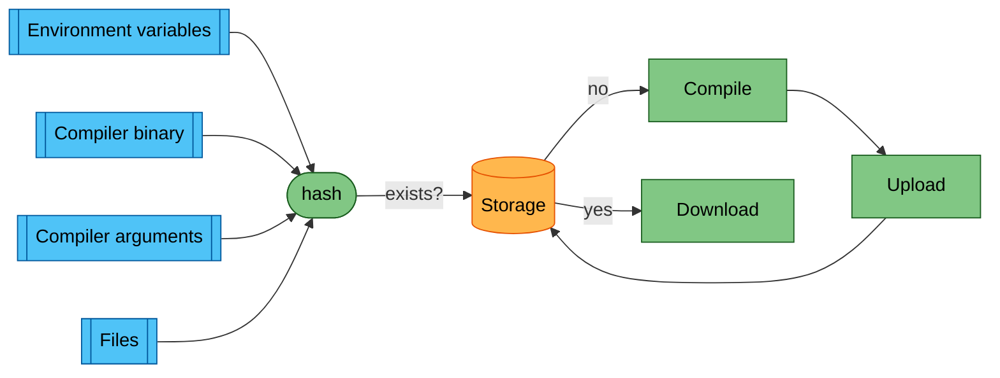
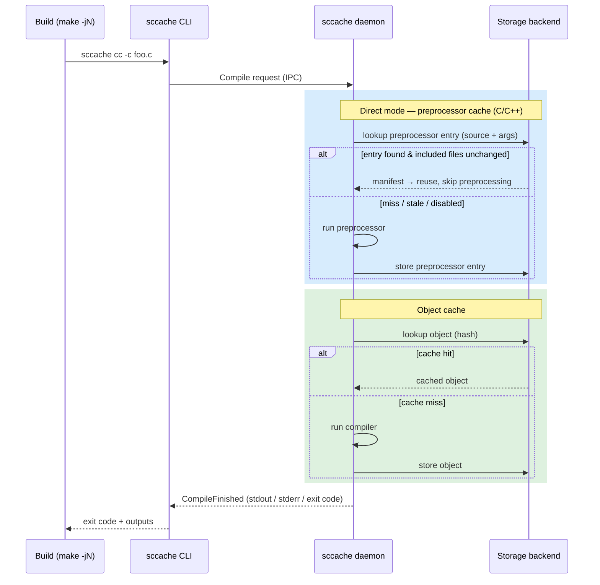
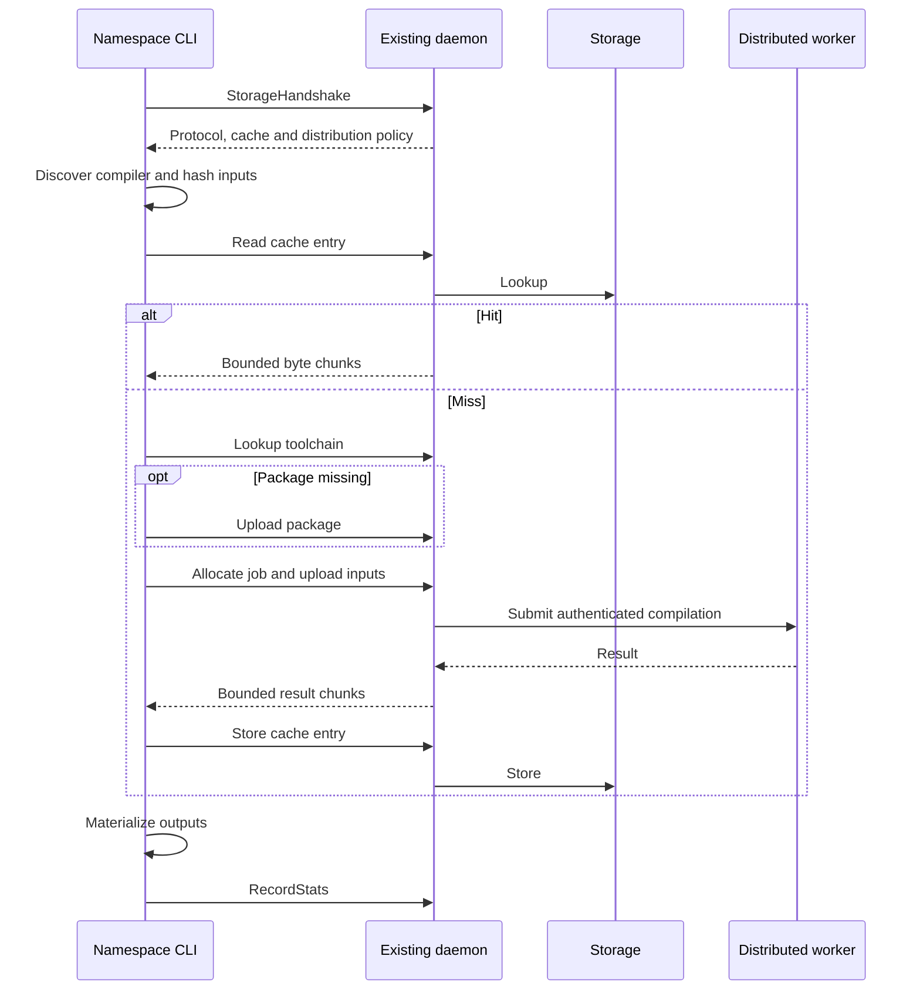

# Sccache high level architecture

This schema shows at a high level how sccache decides whether to compile or to
reuse a cached result.

For more details about how hash generation works, see [the caching documentation](Caching.md).

## Direct mode (preprocessor cache)

For C/C++, sccache can also cache the *preprocessor* result, so that a cache
lookup can skip preprocessing entirely. This is inspired by
[ccache's direct mode](https://ccache.dev/manual/3.7.9.html#_the_direct_mode)
and is described in the [local storage doc](Local.md).

Before computing the object-cache key, sccache looks up a **preprocessor cache
entry** keyed on the source file (path + contents) and the preprocessor
arguments. That entry records every file included by the source. If the entry
exists and all of those included files are unchanged, sccache reuses it and
never runs the preprocessor; otherwise it preprocesses normally and stores a
fresh entry. This step is shown as the blue region in the diagrams below and is
enabled by default (it is skipped for non-C/C++, when disabled, or when certain
flags such as `-Wp,*` / `-Xpreprocessor` are present).

## Execution modes

The caching logic above is the same regardless of *where* it runs. What differs
is which process actually runs the compiler and talks to the storage backend.

sccache is split in two:

- a short-lived **CLI process**, spawned once per compiler invocation (e.g. by
  `make -jN`), and
- a long-lived **daemon** (the background server), which holds the storage
  backend and the accumulated statistics.

The two communicate over a local IPC connection. There are two ways to divide
the work between them.

### Server-side mode (default)

The CLI forwards the whole compilation to the daemon. The daemon runs the
direct-mode preprocessor cache lookup, computes the hash, looks up the object
cache, runs the compiler on a miss, and stores the result. It writes the output
files (e.g. the object file) to disk itself; only the output streams (stdout /
stderr) and the exit code travel back to the CLI.

### Client-side mode (`SCCACHE_CLIENT_SIDE`)

The compile pipeline runs **in the CLI process itself**. The existing daemon
owns storage, statistics, toolchain caching and distributed scheduler
credentials. Compiler discovery, dependency scanning, hashing, and output
materialization run in the caller's filesystem namespace.

On startup the CLI connects to the existing daemon (it never starts one in
client-side mode) and negotiates the namespace IPC protocol and bounded
transfer chunk size. Cache operations use `IpcStorage` and transfer bytes,
not daemon-local filesystem paths. This also works when the caller and daemon
have different files mounted at the same path.

On an eligible cache miss, the namespace client constructs the actual
compiler package and input archive. The daemon reserves each missing
toolchain identity once, imports the package into its existing toolchain
store, and allocates and submits the remote job. The caller receives an opaque
job identifier, never the scheduler credential or signed worker authorization.
The daemon relays the worker result; the caller materializes and caches it.
Transfer staging and toolchain reservations are connection-owned and dropped
on disconnect. A failed remote compilation can fall back to the compiler in
the caller's namespace.

Client-side mode is selected by `SCCACHE_CLIENT_SIDE` or the
`client_side_mode` configuration key. Error logging to a common file remains
incompatible with this mode. Both ends must implement the same namespace IPC
protocol; deployment must update the daemon and its clients together.
