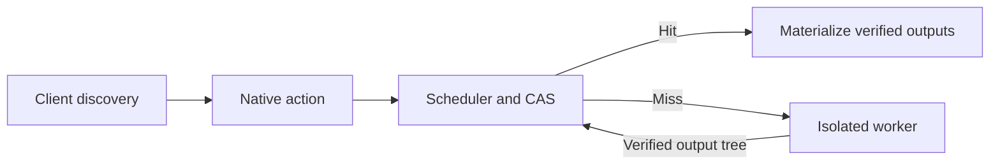

# Native compilation architecture

The only result storage is the scheduler's native content-addressed store.
Compiler jobs never fall back to local compilation. Client discovery may run
compiler metadata queries and preprocessors; actual compilation and linking
are scheduled worker actions in an isolated runtime.

The daemon holds cluster credentials and provides a bounded IPC broker for
namespace clients. A shared multi-UID daemon authenticates Unix peers and
runs input discovery under their credentials and filesystem view, retaining
scheduler authority in the daemon. A failed IPC session terminates the job.

The action identity describes the command and its verified input closure.
Workers obtain immutable CAS inputs, execute the action, and publish verified
output manifests. A cache hit restores the recorded outputs without executing
the action. Rust native linking uses the codegen result and precisely declared
link inputs as dependencies of a separate action. Dependency and toolchain
metadata are not alternate result caches.

See [native CAS](NativeCache.md), [distributed quickstart](DistributedQuickstart.md)
and [configuration](Configuration.md).
